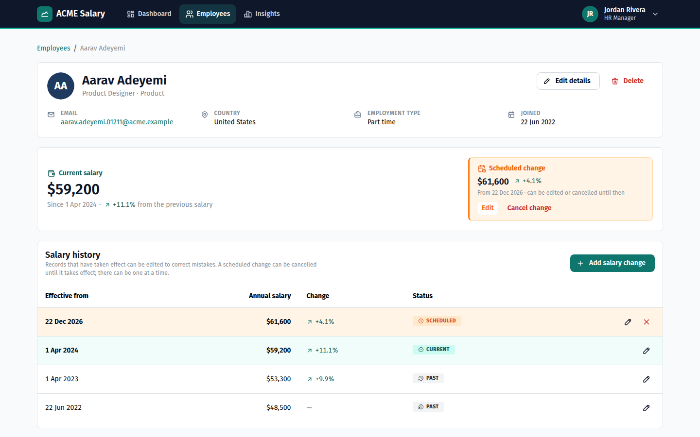
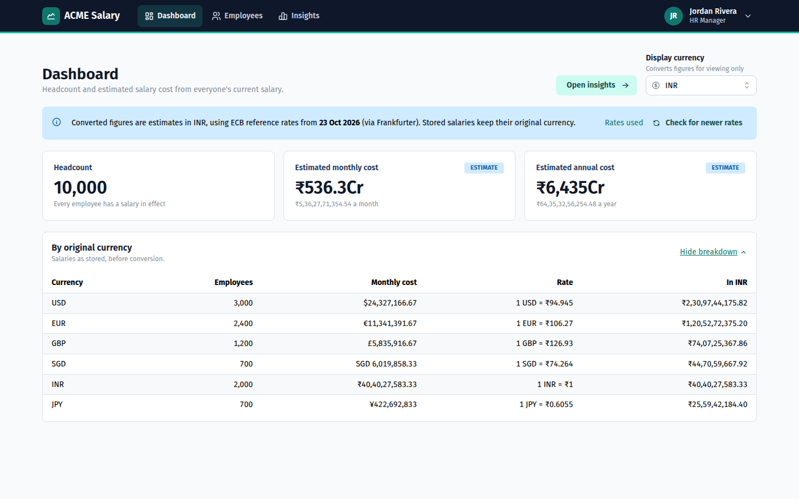
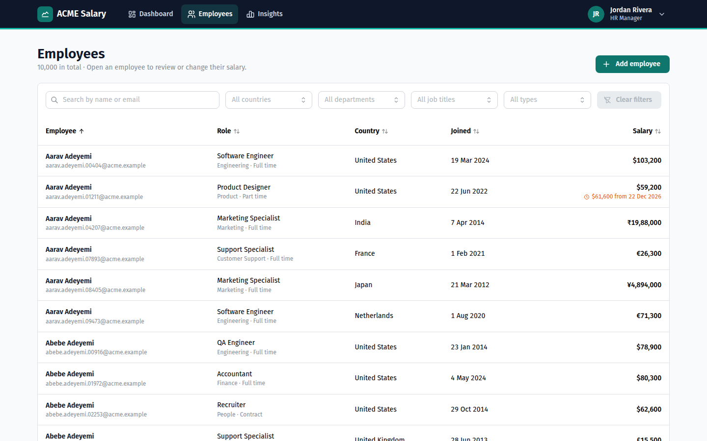
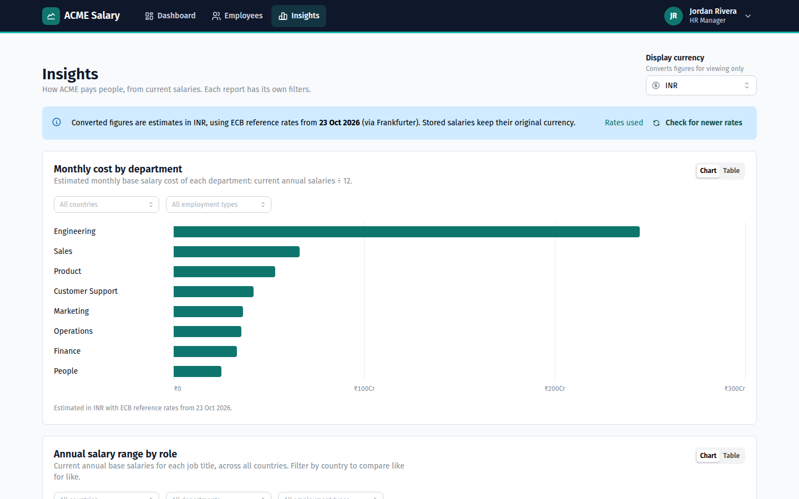
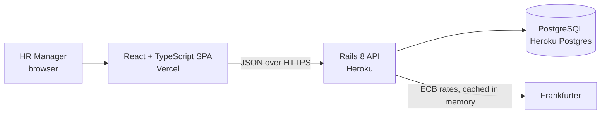

# ACME Salary Management

A web app for an HR Manager to manage salary data for 10,000 employees across eight countries and answer "how do we pay people?" without spreadsheets. It's built as a take-home assessment: a Rails API, a React UI and PostgreSQL, with tests, CI and documents covering each decision.

| | |
| --- | --- |
| **Live app** | https://salary-management-lime-rho.vercel.app |
| **API** | https://salary-management-api-9c972f03ed70.herokuapp.com (health check at `/up`) |
| **Demo video** | [`https://youtu.be/U6mTMmYpzk4`](https://youtu.be/U6mTMmYpzk4), 2 min 22 s |

The live app has no sign-in (see [out of scope](docs/requirements.md#deliberately-out-of-scope-and-why)) and is seeded with 10,000 synthetic employees. Every email uses the reserved `acme.example` domain.



## What the HR Manager can do

- **Find anyone fast.** The directory searches, filters (country, department, job title, employment type), sorts and pages on the server, and stays responsive at 10,000 rows.
- **Manage employees.** Add, edit and delete employees. Creating an employee records their first salary, effective on the joining date, in the same transaction. Validation messages appear on the field they belong to.
- **Keep salary history.** Every change is a dated period that is past, current or scheduled. A back-dated raise becomes current, and a future one is scheduled, with at most one scheduled per employee even under concurrent saves. Any period can be corrected; a scheduled one can be cancelled.
- **See costs at a glance.** The Dashboard shows headcount and estimated monthly and annual cost, with a breakdown by original currency.
- **Answer pay questions.** Insights has three reports: monthly cost by department, annual salary range by role, and salary distribution by country. Ranges show minimum, 25th percentile, median, 75th percentile, maximum and mean, each report has its own filters, and every chart has a table view.
- **Compare across currencies safely.** Salaries are stored in their own currency. Reports convert each salary to one display currency, using dated ECB reference rates, *before* combining figures, and label the results as estimates.

| Dashboard | Directory | Insights |
| --- | --- | --- |
|  |  |  |

## Architecture



| Layer | Choice | Why |
| --- | --- | --- |
| API | Rails 8 (API mode), Ruby 3.4 | The role's stack; validations, migrations and request specs out of the box |
| Database | PostgreSQL | Exact `numeric` money, check constraints, window functions for exact percentiles |
| UI | React 19, TypeScript, Vite, Mantine, TanStack Query | TypeScript catches API contract drift; Mantine provides accessible components |
| Tests | RSpec, Vitest, React Testing Library | Fast and deterministic on each side |

The key design decisions are documented in [`docs/architecture.md`](docs/architecture.md), each with its trade-offs:
- two tables, employees and salary periods
- which rules the database enforces and which the model does
- a row lock plus optimistic locking for concurrent edits
- conversion in `numeric` before aggregation
- exact percentiles instead of the float `percentile_cont`
- exchange rates cached in memory, without Redis

## Repository layout

```
backend/    Rails API: models, query objects, serializers, exchange-rate services, RSpec
frontend/   React app: feature folders (employees, profile, salaries, dashboard, insights), Vitest
docs/       Requirements, architecture, plan, performance, AI workflow, screenshots
.github/    CI: lint, type check, security scans and tests for both apps
```

## Run it locally

You need Ruby 3.4.12 (`backend/.ruby-version`), Node 24 and PostgreSQL.

```sh
# API on http://localhost:3000
cd backend
bundle install
bin/rails db:prepare
bin/rails db:seed        # 10,000 employees with salary history; safe to re-run
bin/rails server

# UI on http://localhost:5173 (in a second terminal)
cd frontend
npm install
npm run dev
```

The defaults suit local development. The variables (business time zone, CORS origins, API URL, exchange-rate source) are listed in [`backend/.env.example`](backend/.env.example), [`frontend/.env.example`](frontend/.env.example) and the [configuration table](docs/architecture.md#configuration).

## Tests and quality

| Suite | Command | Size | Time |
| --- | --- | --- | --- |
| Backend: models, queries, services, requests, 10k-row performance check | `cd backend && bundle exec rspec` | 172 examples | about 12 s |
| Frontend: components, pages, utilities, API client | `cd frontend && npm test` | 76 tests | about 9 s |

- **CI** runs on every push and pull request: RuboCop, Brakeman, bundler-audit and RSpec on PostgreSQL for the backend; ESLint, the TypeScript check, Vitest and the production build for the frontend.
- **Tests come from the requirements**, not from the implementation. For example, the concurrency spec was shown to fail without the lock. Percentile and cost specs use figures worked out by hand from known data.
- **Performance** was measured on 10,000 employees and 35,080 salary periods: reports take 62–130 ms and directory pages 52–108 ms over HTTP. See [`docs/performance-considerations.md`](docs/performance-considerations.md).

## Deployment

| Part | Host | How |
| --- | --- | --- |
| API | Heroku (heroku-24, Basic dyno) | `git subtree push --prefix backend heroku main`. The `Procfile` runs migrations as the release step |
| Database | Heroku Postgres (essential-0) | Seeded once with `heroku run bin/rails db:seed` |
| UI | Vercel (static Vite build) | `vercel deploy --prod` from `frontend/`. `vercel.json` sends every route to `index.html` |

Production settings: `RAILS_MASTER_KEY`, `APP_TIME_ZONE=Asia/Kolkata` and `CORS_ORIGINS` (the Vercel URL) on Heroku, and `VITE_API_BASE_URL` (the Heroku URL) on Vercel. More in [Deployment](docs/architecture.md#deployment).

## Documents

| Document | What's in it |
| --- | --- |
| [Requirements](docs/requirements.md) | One page: goal, persona, scope, key decisions, what's left out and why, success criteria |
| [Architecture](docs/architecture.md) | Data model, salary-period rules and concurrency, exchange rates, insight calculations, API, UI, configuration, deployment |
| [Planning](docs/planning.md) | Milestones, commit strategy, definition of done, risks |
| [Performance](docs/performance-considerations.md) | Measured timings, query-plan choices, the planner-statistics fix, test-suite speed |
| [AI workflow](docs/ai-workflow.md) | How AI was used each milestone: prompts, what it produced, what it got wrong and how that was caught |
| [Demo video](https://youtu.be/U6mTMmYpzk4) | A silent walkthrough of every flow, with captions |

## How AI was used

The app was built with Claude Code, one reviewed increment at a time. I set the scope, the data model and the trade-offs; generated code was run and tested before each commit. [`docs/ai-workflow.md`](docs/ai-workflow.md) records the prompts and the mistakes that review caught. Examples: a concurrency spec that passed even with the lock removed, `master.key` nearly being committed, and Frankfurter silently mixing data from non-ECB providers.
