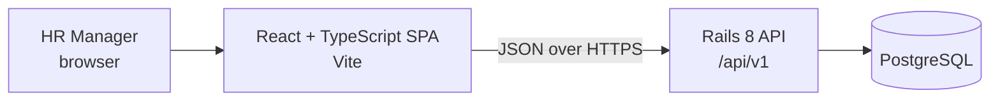
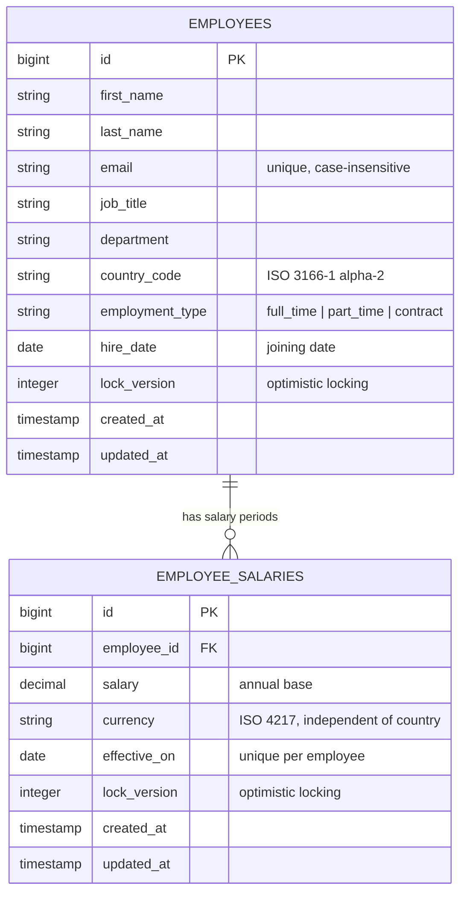

# Architecture

This document describes the current design. Each section records its decisions and their trade-offs next to the design they apply to, and is kept in step with the code.

## Overview



The app has two parts in one repository: a Rails API-only backend in `backend/` and a React single-page app in `frontend/`. Each part is built, tested, and deployed on its own, and they share nothing except the HTTP contract, which is documented in [API](#api).

## Why this stack

| Choice | Reason |
| --- | --- |
| **Rails (API mode)** | It's the role's preferred stack. It provides validations, migrations, and request specs out of the box, and has very little boilerplate for a CRUD and reporting API. |
| **PostgreSQL** | The brief asks for a relational database. Postgres has `percentile_cont` for medians, `FILTER` and `GROUP BY` for reporting, check constraints, and expression indexes. It's also what we'd deploy, so development and production behave the same. |
| **React + TypeScript + Vite** | The brief asks for React. TypeScript catches mismatches with the API contract at compile time, and Vite makes the dev server and build fast. |
| **RSpec, Vitest, React Testing Library** | These are the standard tools for each side, and they run fast and give deterministic results. |

## Data model

The data model is the core of this app. Workflows edit employee and salary-period records, and insights aggregate over both, so getting their shape, constraints, and indexes right matters more than anything else in the design.

### Principles

1. **Separate employee details from salary periods.** One employee can have many salary records, each effective from a date, while employee attributes remain on one row.
2. **Money is stored exactly, in the currency HR records.** No conversion happens on write or read. A salary period's currency is independent of the employee's country, so every statistic must be grouped by currency, and no figure ever mixes currencies.
3. **The database guards the essentials; the models own the business rules.** The database enforces structural invariants. Business rules such as the salary-period rules live in the `Employee` and `EmployeeSalary` models. See [Where each rule is enforced](#where-each-rule-is-enforced).
4. **No structure we don't need yet.** Reference values (department, job title, country) are validated strings rather than lookup tables. The schema leaves clear paths to add other reference tables later (see [Future evolution](#future-evolution)).

### Entity diagram



Salary periods are stored in `employee_salaries`, one row per change. A period applies from `effective_on` until the employee's next period; current salary is the latest period effective on or before today. Future-dated (pending) periods do not affect the current salary. The rules for adding, editing and cancelling periods are in [Salary periods: rules and concurrency](#salary-periods-rules-and-concurrency).

### `employees` table

| Column | Type | Database constraint | Model validation |
| --- | --- | --- | --- |
| `id` | bigint PK | | |
| `first_name`, `last_name` | string(100) | `NOT NULL` | not blank, ≤ 100 chars, stripped of surrounding whitespace |
| `email` | string(254) | `NOT NULL`, unique index on `lower(email)` | not blank, valid format, unique (case-insensitive); stripped and downcased before save |
| `job_title` | string(100) | `NOT NULL` | not blank, ≤ 100 chars, stripped |
| `department` | string(100) | `NOT NULL` | not blank, ≤ 100 chars, stripped |
| `country_code` | string(2) | `NOT NULL` | one of the supported countries |
| `employment_type` | string | `NOT NULL` | one of `full_time`, `part_time`, `contract` (Rails `enum` with string values) |
| `hire_date` | date | `NOT NULL` | not in the future; not after the first salary period |
| `lock_version` | integer | `NOT NULL DEFAULT 0` | optimistic locking (Rails) |
| `created_at`, `updated_at` | timestamp | `NOT NULL` | set by Rails |

### `employee_salaries` table

| Column | Type | Database constraint | Model validation |
| --- | --- | --- | --- |
| `id` | bigint PK | | |
| `employee_id` | bigint FK | `NOT NULL`, references `employees` | required |
| `salary` | decimal(14,2) | `NOT NULL`, `CHECK (salary > 0)` | greater than zero; whole number for JPY |
| `currency` | string(3) | `NOT NULL` | a supported currency; defaults to the country's currency (INR if none) |
| `effective_on` | date | `NOT NULL`, unique with `employee_id` | on or after the joining date; past, today or future; at most one future-dated period per employee |
| `lock_version` | integer | `NOT NULL DEFAULT 0` | optimistic locking (Rails) |
| `created_at`, `updated_at` | timestamp | `NOT NULL` | set by Rails |

`Employee.create_with_first_salary` creates an employee and their first salary period, effective on the joining date, in one transaction; the seed does the same in bulk. Each salary change adds another row. Changing an employee's country never touches their salary periods. Correcting the joining date with `Employee#update_with_lock` moves the first salary period with it when that period started on the old joining date. The Rails association deletes salary periods when an employee is destroyed.

### Supported countries and currencies

Countries, their usual currencies and the supported salary currencies are defined in one place: the `Country` module (`app/models/country.rb`), a frozen constant with no database table. It drives model validation, the seed script, and the options the UI offers (served by `GET /api/v1/meta`). A country's currency is only the default for a new salary period; HR can choose any supported currency, and the app-wide default is INR. Adding a country or currency is a code change only.

| Country | `country_code` | `currency` |
| --- | --- | --- |
| United States | `US` | `USD` |
| United Kingdom | `GB` | `GBP` |
| Germany | `DE` | `EUR` |
| France | `FR` | `EUR` |
| Netherlands | `NL` | `EUR` |
| India | `IN` | `INR` |
| Japan | `JP` | `JPY` |
| Singapore | `SG` | `SGD` |

The supported salary currencies are USD, GBP, EUR, INR, JPY and SGD. The set mixes currencies with and without a minor unit (JPY).

### Design decisions

- **Why store currency on each salary period, independent of country.** Each salary row carries its own unit, so pay stays interpretable when an employee moves country or is paid in a currency other than their country's (for example a contractor in India paid in USD). The country only supplies the default currency.
- **Why salary periods are editable.** HR needs to correct mistakes in any period, including the initial and past ones. The trade-off is that a correction overwrites the old value; there is no audit log yet (see requirements).
- **Why one period per employee per date.** Two periods on the same day would make the current salary ambiguous. The unique index also serves the history and current-salary lookups.
- **Why optimistic locking.** Two HR users can open the same record. `lock_version` makes the second save fail with a conflict instead of silently overwriting the first.
- **Why `decimal(14,2)` and not integer cents.** Some currencies (for example JPY) have no minor unit, so a fixed "cents" assumption is wrong. `decimal` stores exact values, never has floating-point rounding errors, and aggregates (`SUM`, `AVG`, `percentile_cont`) run directly in SQL. 14 digits leaves ample headroom for large nominal amounts such as INR or JPY salaries.
- **Why strings and not lookup tables for department, job title, and country.** At this scope these values have no behaviour of their own, and normalising them would add joins and admin screens nobody needs yet. Filtering and grouping on an indexed string column is just as fast at 10,000 rows.
- **Why `lower(email)` and not `citext`.** A unique expression index gives case-insensitive uniqueness without a Postgres extension, which keeps setup and hosting simpler.
- **Why no soft delete.** The product does not require retaining deleted employee data. Delete is a real delete; soft delete would leak a `deleted_at` filter into every query.

### Where each rule is enforced

| Rule | Database | Model |
| --- | --- | --- |
| Employee fields present | `NOT NULL` | ✓ |
| Employee text length limits | column `limit` | ✓ |
| Email unique, case-insensitive | unique index on `lower(email)` | ✓ |
| Salary period fields present | `NOT NULL` | ✓ |
| Salary greater than zero | `CHECK (salary > 0)` | ✓ |
| One salary period per employee per date | unique index on `(employee_id, effective_on)` | ✓ |
| No lost updates from concurrent edits | `lock_version` column | Rails optimistic locking |
| At most one pending period per employee | employee row lock (`SELECT … FOR UPDATE`) | ✓ (checked inside the lock) |
| Text fields not blank (whitespace only) | | ✓ |
| Email format; stored lowercase and stripped | | ✓ |
| Country supported; salary currency supported | | ✓ |
| Whole-number salary for JPY | | ✓ |
| Employment type in the allowed set | | ✓ |
| Hire date not in the future, not after the first salary period | | ✓ |
| Effective date on or after the joining date | | ✓ |
| Only a pending period can be cancelled; at least one period remains | | ✓ |

**Decision.** The database enforces only the invariants that are structural and stable: a row must be complete, emails must not collide, and a salary must be a positive amount. Breaking any of these would corrupt lookups or every aggregate, and none of them changes as the business changes. Uniqueness in particular must be in the database, because a model-level check alone is open to a race between two concurrent saves.

The rest are business rules, and they live in the relevant model:

- **One source of truth.** The supported countries and currencies, the zero-decimal currencies, and the employment types are defined once in Ruby. Mirroring them in `CHECK` constraints would duplicate those lists in SQL and require a migration to keep both in step whenever a country or type is added.
- **Simpler schema and migrations.** The schema stays readable, and changing a business rule is a code change with a spec, not a schema change.
- **Some rules can't be a constraint anyway.** "Hire date not in the future" and "at most one pending period" depend on today's date, and Postgres requires `CHECK` expressions and partial-index predicates to be immutable.

**Trade-off.** Anything that bypasses Active Record validations can store data that breaks a model-only rule. That includes `insert_all`, `update_columns`, raw SQL, or a future bulk import. In this app the only such path is the seed script, so:

- The seed generator builds employee and salary rows from the same definitions the models validate against. Currency comes from `Country.currency_for`, employment type from the allowed set, and names, departments and job titles from fixed non-blank lists. JPY salaries are rounded to 1,000.
- Insights will use only the current effective salary period and group by employee country and salary currency.
- Any future import path must go through the model or reuse its validations.

### Indexes and the queries they serve

| Index | Serves |
| --- | --- |
| `lower(email)` unique | Uniqueness, and search by email |
| `department` | Directory filter by department |
| `(country_code, job_title)` | "Job titles within a country" insights, the most common like-for-like comparison, and the combined country + job title filter |
| `(country_code, department)` | "Departments within a country" insights |
| `(employee_id, effective_on)` unique on `employee_salaries` | One period per date; salary history; the current and pending salary lookups (the directory's `LATERAL` subqueries) |

There is no standalone `country_code` index. Both composite indexes start with `country_code`, so Postgres can use either one for a filter or grouping on country alone.

Name search uses `ILIKE` on first name, last name, full name and email, with LIKE wildcards in the input escaped. At 10,000 rows this is fast without a trigram index: on the seeded development database a warm directory page takes about 10–60 ms, including a name search and a deep page (page 400). Full measurements will be recorded in `performance-considerations.md`.

### How insights use the model

The Dashboard and the Insights page answer "how do we pay people" in one **display currency** the user picks from the six supported currencies (default INR). Each report has its own filters and never filters on the dimension it groups by.

| Report | Groups by | Filters |
| --- | --- | --- |
| Dashboard summary | nothing (optional breakdown by original currency) | none |
| Monthly cost by department | department | country, employment type |
| Annual salary range by role | job title | country, department, employment type |
| Annual salary distribution by country | country | department, job title, employment type |

*Headcount* counts every matching employee; employees with no salary in effect yet are shown separately and left out of salary figures. *Monthly cost* is the sum of current annual base salaries divided by 12, for all employment types, with no bonus or employer costs. Ranges and distributions are annual; costs are monthly.

Every report starts from the same set: each employee joined to their **current salary**, the latest period with `effective_on <= today` (a `DISTINCT ON (employee_id)` CTE in `Insights::Report`; on the 10,000-employee seed with 35,080 salary periods it aggregates in about 21 ms, against 28 ms for a `LATERAL` lookup per employee). Pending and superseded periods never count.

Each salary is then **converted before anything is combined**. A `rates` CTE built from the pinned rate set (see [Exchange rates](#exchange-rates)) holds each currency's EUR-based rate, and the converted annual salary is `salary * eur_rate(display) / eur_rate(salary currency)`, computed in `numeric` (multiply first, then divide). Salaries already in the display currency are multiplied by exactly 1. Stored salaries are never written.

| Statistic | How it is calculated |
| --- | --- |
| Headcount | `COUNT(*)` over employees; those without a current salary are counted separately |
| Monthly cost | `SUM(converted) / 12`, exact `numeric`, rounded once |
| Mean, minimum, maximum | `AVG`, `MIN`, `MAX` over converted values, exact `numeric` |
| 25th percentile, median, 75th percentile | **Exact** linear interpolation in `numeric` (below) |

**Exact percentiles.** PostgreSQL's `percentile_cont` casts `numeric` input to `double precision`, so its results are floats. The reports compute the same definition in `numeric` instead. Each group's converted values are numbered in order with `row_number()` (`rn`, from 0) and counted (`n`). For a fraction `p`, the position is `h = p × (n − 1)`, and the percentile is `v[floor(h)] + (h − floor(h)) × (v[ceil(h)] − v[floor(h)])`, picked with `MIN(v) FILTER (WHERE rn = …)`. For {10, 20, 30, 100} this gives 17.5, 25 and 47.5, which matches `percentile_cont` but with no float step.

**Rounding.** Figures are rounded once, at the end, half away from zero, to the display currency's minor unit: 2 decimals, or 0 for JPY. Original-currency figures are rounded to their own currency's minor unit. Amounts are serialized as strings with two decimals (`"1651517.00"` for JPY).

At 10,000 rows aggregating on request takes tens of milliseconds, so there are no precomputed summaries that could go stale, and figures change as soon as a salary is edited.

### Seed data

`db/seeds.rb` calls `EmployeeSeed` (`lib/employee_seed.rb`) to create 10,000 synthetic employees with salary history: 35,080 salary periods in total.

- **Deterministic.** Headcount per country (US 3000, IN 2000, GB 1200, DE 1000, FR 800, JP 700, SG 700, NL 600) and per job title within each country is allocated from fixed weights. Every country therefore has all 8 departments and all 18 job titles, with at least 10 employees per country–job-title group and at least 30 per country–department group. Names, salary variation, employment type and hire date come from a fixed random seed, so every run produces identical data.
- **Exact salaries.** Generated from a per-title base, a country pay factor, ±20% variation and a part-time reduction, using Integer and Rational arithmetic only. Rounded to whole units (nearest 100, or 1,000 for INR and JPY).
- **Salary history.** Every employee's first period starts on their hire date. At each annual review (1 April), starting at least six months after hiring and up to today, an employee gets a raise of 3–12% with a 60% chance; the latest three raises are kept. About 5% (523) also have one pending raise 14–120 days ahead. The generated salary is the *current* one, and earlier periods are worked out backwards from it, so the insight figures don't depend on the history. History uses a second random stream, so the employees themselves are identical to the earlier seed. Review and pending dates depend on the day the seed runs.
- **Planner statistics.** After the bulk insert the seed runs `ANALYZE employees, employee_salaries`. Without it, Postgres can keep planning for empty tables until autovacuum runs, and reports then take seconds instead of milliseconds.
- **No real personal data.** Names are random combinations of common first and last names. Emails use the reserved `.example` domain (`first.last.00042@acme.example`).
- **Safe to re-run.** Employee and salary rows are inserted in batches and in the same transaction. A second run skips existing employees and does not add or overwrite their salary periods, so a database seeded before salary history existed needs a reset to get it.
- **Limitation.** If HR changes a seeded employee's email, re-running the seed re-creates the original seeded record.

### Future evolution

The model is deliberately small, but it is shaped so the likely next steps are additive:

- **Reference data with behaviour** (for example per-department budgets, or job levels): promote the string column to a lookup table with a foreign key, using a data migration from the existing distinct values.
- **Historical or durable rates:** reports convert with the latest ECB rates, cached in memory. Converting each salary at the rate of its own effective date, or keeping rates across restarts, would need a durable store (a table or a shared cache).

## Salary periods: rules and concurrency

### States

"Today" is `Date.current` in the business time zone (`APP_TIME_ZONE`, default `Asia/Kolkata`). SQL never uses `CURRENT_DATE`; today is always passed in from Ruby, so the database, the API and the UI agree on the date. The UI takes today from `GET /api/v1/meta`, not from the browser clock.

| State | Definition | Edit | Cancel |
| --- | --- | --- | --- |
| **Pending** | `effective_on > today`; at most one per employee | ✓ | ✓, unless it is the employee's only period |
| **Current** | the latest period with `effective_on <= today` | ✓ (to correct a mistake) | ✗ |
| **Past** | any other period with `effective_on <= today` | ✓ (to correct a mistake) | ✗ |

A period effective today is current, not pending. An edit can move a period to any valid date, including into the future, as long as no other period is pending. Cancelling is decided by the stored date, not by an unsaved edit, and deletes the row.

### Preventing two pending periods under concurrent requests

The rule "at most one pending period" depends on today's date, so it can't be a `CHECK` constraint or a partial unique index (Postgres requires both to be immutable). Instead every salary write goes through `EmployeeSalary#save_with_lock` or `#destroy_with_lock`, which run inside `employee.with_lock`:

```ruby
employee.with_lock do   # BEGIN; SELECT … FROM employees WHERE id = ? FOR UPDATE
  save                  # validations, including "no other pending period", then INSERT/UPDATE
end                     # COMMIT
```

Two requests for the same employee therefore run one after the other. The second one waits on the row lock until the first commits; under `READ COMMITTED` its validation query then sees the first request's row, so it fails with a validation error. Requests for different employees don't block each other.

The model spec `concurrent requests` proves this with four threads on separate connections. It holds each request between its check and its `INSERT`, so without the lock all four requests would pass the check: the spec gets four pending rows without the lock and exactly one with it.

**Alternatives considered:**

| Option | Verdict |
| --- | --- |
| Row lock on the employee (chosen) | Simple, local to one employee, works on any Postgres. It keeps the rule in the model with the other business rules. |
| A `status` column flipped by a nightly job, plus a partial unique index | Stores state that goes stale at midnight and needs a scheduler. |
| `SERIALIZABLE` transactions | Correct, but every caller needs retry handling. |
| Advisory lock | Same effect as the row lock, but less discoverable. |
| A trigger | Would also guard writes that bypass Active Record. Not needed while every write goes through the model; worth adding with a bulk import. |

The unique `(employee_id, effective_on)` index and `lock_version` are the database backstops: the index stops same-date duplicates, and optimistic locking turns an edit based on an outdated copy into a `409 stale_record`.

## Exchange rates

Reports convert salaries into a display currency (one of the six supported currencies, default INR) with **ECB reference rates** fetched from [Frankfurter](https://frankfurter.dev).

- **Request.** `GET {EXCHANGE_RATES_URL}/rates?base=EUR&quotes=USD,INR,GBP,JPY,SGD&providers=ECB`. Frankfurter's v2 API blends several providers unless `providers=ECB` is given; with it, every row is an ECB reference rate dated with the ECB working day it was published on (weekends return Friday's rates).
- **Rate sets in memory, no Redis, no table.** A complete, validated response becomes one `ExchangeRates::RateSet` (provider, base, `rate_date`, `fetched_at`, and the six EUR-based rates, EUR = 1), stored as **one value** in `Rails.cache`, which is `:memory_store` (32 MB) in development, test and production. `ExchangeRates::Store` keeps each set under its token, plus the latest token, the time of the last check, and a 5-minute failure marker. Every set also stays readable by token after a newer one arrives, so pinned reports keep their rates.
- **Token.** Each set's token is opaque to the UI: `r_` plus a SHA-256 digest of the provider, base, date and rates. The same ECB data gives the same token in every process and after a restart.
- **Validation.** A set is cached only if the response is complete: one row for each of USD, INR, GBP, JPY and SGD, all with base EUR, the same date, a date that is neither in the future nor a weekend (ECB never publishes at weekends, so a weekend date means another provider's data), and finite positive rates. Anything else is rejected and logged, and the last cached set stays in use.
- **Refresh.** `GET /exchange_rates/current` returns the latest cached set. It fetches first if nothing is cached or the last check was more than `EXCHANGE_RATES_REFRESH_HOURS` ago (default 6), with a 2-second connect and 3-second read timeout. One thread per process refreshes at a time (a `Mutex#try_lock`); other requests use the cached set instead of waiting. A slow or failing provider only means the cached set is used; after a failure the process waits 5 minutes before trying again.
- **One rate set per page.** The Dashboard and Insights pages fetch `/exchange_rates/current` once and send its `rates_token` with every report request. Reports never refresh rates, so all reports on a page use the same set, even if a newer one arrives meanwhile. Each report repeats the `conversion` metadata, including the token, so this can be checked.
- **Limitation: the cache is lost on restart, and each process has its own.** After a deploy or restart nothing is cached until the first `/exchange_rates/current` request fetches again; if Frankfurter is down at that moment, reports have no rates (`unavailable`) until it recovers. A page pinned to a token from before the restart gets a 409 and re-pins. Because tokens are digests of the data, separate Puma workers that fetched the same ECB rates agree on the token; a worker that has not fetched yet answers 409 for a token it doesn't hold, and the page re-pins through it.
- **Freshness.** Every report includes `conversion.status`:

| Status | Meaning |
| --- | --- |
| `current` | Rates are at most 4 days older than today (covers weekends and single holidays) |
| `stale` | Older than that; figures are shown with a warning |
| `not_needed` | Every salary in the result is already in the display currency; no rates are used, so this works with nothing cached |
| `unavailable` | Rates are needed but none are cached. Converted fields are `null`; headcount and original-currency figures are still returned (HTTP 200) |

## API

All endpoints are under `/api/v1` and speak JSON. Amounts are decimal **strings** with two decimals (`"72000.00"`), so no client parses money into a float by accident; dates are `YYYY-MM-DD`.

**Errors** always have this shape:

```json
{ "error": { "code": "validation_failed", "message": "Effective date can't be before the joining date (2022-01-03)", "details": { "effective_on": ["can't be before the joining date (2022-01-03)"] } } }
```

| Status | `code` | When |
| --- | --- | --- |
| 400 | `bad_request` | The request body is missing its root key (`employee`, `salary_record`) |
| 404 | `not_found` | Unknown employee, or a salary period that belongs to another employee |
| 409 | `stale_record` | `lock_version` is outdated: someone saved the record after it was loaded |
| 409 | `conflict` | A uniqueness race the model check couldn't see |
| 422 | `validation_failed` | Any validation rule, including "one pending period" and "can't cancel" |

**Endpoints**

| Method and path | Purpose | Notes |
| --- | --- | --- |
| `GET /meta` | Reference data | `today`, `time_zone`, `default_currency`, `countries` (`code`, `name`, `currency`), `currencies` (`code`, `zero_decimal`), `employment_types`, and the distinct `departments` and `job_titles` |
| `GET /employees` | Directory | Query: `page` (default 1), `per_page` (default 25, max 100), `q`, `country_code`, `department`, `job_title`, `employment_type`, `sort` (`name`, `job_title`, `country` by country name, `hire_date`, `salary`, `created_at`; unknown values fall back to `name`). `salary` sorts by the current salary's currency and then the amount, because amounts in different currencies can't be compared; employees with no current salary come last, `direction` (`asc`, `desc`). Returns `{ data, meta: { page, per_page, total, total_pages } }`. A page past the end returns an empty `data` |
| `POST /employees` | Create | `{ employee: { …details, first_salary: { salary, currency? } } }`. Creates the first salary period effective on `hire_date`. Errors for the salary are keyed `first_salary.salary` and `first_salary.currency` |
| `GET /employees/:id` | Profile | Employee details |
| `PATCH /employees/:id` | Update | `{ employee: { …details, lock_version } }`. Country changes leave salary periods untouched |
| `DELETE /employees/:id` | Delete | Deletes the employee and all their salary periods. Returns 204 |
| `GET /employees/:id/salaries` | History | `{ data: [ … ] }`, newest first |
| `POST /employees/:id/salaries` | Add a period | `{ salary_record: { salary, effective_on, currency? } }`. Returns 201 with the full history |
| `PATCH /employees/:id/salaries/:sid` | Correct a period | `{ salary_record: { salary?, currency?, effective_on?, lock_version } }`. Returns the full history |
| `DELETE /employees/:id/salaries/:sid` | Cancel a pending period | 204, or 422 if it has taken effect or is the only period |
| `GET /exchange_rates/current` | Rate set to pin | `{ rate_set: { token, provider, base, rate_date, fetched_at, rates } \| null, status }` (`status` is `current`, `stale` or `unavailable`). May refresh the cached rates |
| `GET /insights/summary` | Dashboard | Query: `currency`, `rates_token`. Returns `headcount`, `without_current_salary`, `monthly_cost`, `annual_cost`, `by_currency` (`currency`, `headcount`, `monthly_cost_original`, `annual_cost_original`, `rate`, `monthly_cost`), `conversion` |
| `GET /insights/department_costs` | Report 1 | Query: `currency`, `rates_token`, `country_code`, `employment_type`. Returns `data` (`department`, `headcount`, `without_current_salary`, `monthly_cost`, `share_percent`) sorted by cost, `by_currency` (`department`, `currency`, `monthly_cost_original`), `conversion` |
| `GET /insights/role_salary_ranges` | Report 2 | Query: `currency`, `rates_token`, `country_code`, `department`, `employment_type`. Returns `data` (`job_title`, `headcount`, `min`, `p25`, `median`, `p75`, `max`, `mean`, all annual) and `conversion` |
| `GET /insights/country_salary_distribution` | Report 3 | Query: `currency`, `rates_token`, `department`, `job_title`, `employment_type`; no country filter. Returns the same fields per country for every country, and `conversion` |

Insight requests reject an unsupported `currency` with 422. Without `rates_token` they use the latest cached rate set; `rates_token=none` pins "no rates", so a page that loaded without rates keeps every report consistent. A token the cache no longer holds (after a restart) gets **409 `unknown_rates_token`**; the page then fetches `/exchange_rates/current` again and reruns its reports. `conversion` is `{ display_currency, status, rates_token, provider, rate_date, fetched_at, rates }`, where `rates` maps each currency used to "1 unit = n display currency" (as a string).

An employee (directory row or profile) has `id`, `first_name`, `last_name`, `email`, `job_title`, `department`, `country_code`, `country_name`, `employment_type`, `hire_date`, `lock_version`, and `current_salary` and `pending_salary`, each `{ id, salary, currency, effective_on }` or `null`.

A salary period in the history has `id`, `salary`, `currency`, `effective_on`, `status` (`pending`, `current` or `past`), `cancellable`, `lock_version`, and `change` (`{ amount, percent }` compared with the previous period, or `null` for the first period or a currency change).

## Backend structure

- **Controllers** (`app/controllers/api/v1/`) stay thin: they permit parameters, call the model and render. `BaseController` maps exceptions to the error format above.
- **Models** own validations, the salary-period rules and the locked write methods (`Employee.create_with_first_salary`, `Employee#update_with_lock`, `EmployeeSalary#save_with_lock`, `EmployeeSalary#destroy_with_lock`).
- **Query objects** (`app/queries/`) build the larger reads in SQL. `EmployeeDirectoryQuery` filters, sorts and paginates the directory and joins each row's current and pending salary through two `LATERAL` subqueries, so a page is one query plus a count, with no N+1. The insight queries live in `app/queries/insights/`, and the exchange-rate code (`RateSet`, the cache `Store`, the Frankfurter client and refresh) in `app/services/exchange_rates/`.
- **Serializers** (`app/serializers/`) are plain classes that list exactly which fields the API exposes.

## Frontend structure

```
src/
  api/          types mirroring the API, fetch client (ApiError), TanStack Query hooks
  components/   app shell (header, demo HR profile), date field, error and not-found states
  features/
    employees/  directory page, filters, table, URL state, add/edit employee modal
    profile/    employee profile, salary summary, salary history table
    salaries/   add/correct salary modal, effective-date preview
    dashboard/  dashboard: headcount and estimated cost tiles, original-currency breakdown
    insights/   insights page, the three reports, display-currency picker, rates note,
                per-report URL filters, and the bar and range charts (charts/)
  lib/          formatting, date parsing, mapping server errors onto form fields
  test/         Vitest setup and helpers (mocked fetch, providers)
```

- **Data fetching:** TanStack Query. Every write invalidates the employee queries and `meta`, so the directory, profile, history and filter options stay in step. The directory keeps the previous page on screen while the next one loads.
- **Components:** Mantine 9 (tables, forms, selects, date inputs, modals, notifications) with Tabler icons.
- **Directory table:** every column sorts on the server. The salary column shows the current salary, with a scheduled change as a second line only when there is one.
- **Profile:** one salary card shows the current salary and its change from the previous one (or "Starting salary"). The scheduled change appears as a highlighted panel in that card only when it exists, so nothing renders as an empty slot.
- **Dashboard and Insights:** both pages fetch the current rate set once (`staleTime: Infinity`) and send its token (or `none`) with every report request, so all reports on a page convert with the same rates. On a 409 `unknown_rates_token` the page re-pins once and reruns its reports. The display currency lives in the URL (`?currency=`) and is remembered per browser; each report's filters live in the URL under its own prefix (`dept.`, `role.`, `dist.`). Salary edits refresh the reports but not the pinned rates.
- **Charts:** small HTML/CSS components rather than a chart library. Horizontal bars (at most 24px thick, 4px rounded end, hairline gridlines) and range rows (min–max whisker, 25th–75th percentile box, median tick). Each mark is keyboard-focusable with a tooltip and a full text label, and every report has a table view with the exact figures.
- **Routing:** React Router. The directory's search, filters, sort and page live in the URL, so views can be bookmarked and the Back button restores them; the profile's breadcrumb returns to the same list view.
- **Forms:** Mantine form with validation on blur and on submit. Server validation errors are shown under the matching field. A `409 stale_record` keeps the modal open and offers to load the latest values. The form sends the `lock_version` it was opened with, so a save can't overwrite someone else's edit.

## UI design

A light, minimal "Swiss" style for a data-dense internal tool, chosen with the UI/UX Pro Max skill. Its palette search had no single navy-and-teal match, so the palette combines its "B2B navy" and "trust teal" palettes.

| Token | Value | Use |
| --- | --- | --- |
| Navy 9 | `#0F172A` | Header, headings |
| Navy 7 | `#1E3A5F` | Avatar, secondary emphasis |
| Teal 7 (primary) | `#0F766E` | Buttons, links, current status (white text at 5.5:1) |
| Teal 4–5 | `#2DD4BF`, `#14B8A6` | Header accent line, focus rings, never text |
| Orange | Mantine orange | Scheduled (pending) changes |
| Background / card / border | `#F8FAFC` / `#FFFFFF` / `#E2E8F0` | Surfaces |

- **Typography:** Fira Sans, with tabular numbers for money and dates so columns line up.
- **States:** skeletons on first load, a thin progress bar while a new page loads, an error card with "Try again", and distinct empty states for "no employees yet", "no matches" and "page past the end".
- **Accessibility:** visible labels and helper text on every field, errors next to the field, keyboard-reachable rows (the name is a real link), `aria-sort` on sortable headers, labelled icon buttons, a skip link, increases and decreases shown with an arrow and a sign (not colour alone), and `prefers-reduced-motion` respected.
- **Responsive:** filters stack on small screens, tables scroll inside their card, and modals go full screen on phones.

## Configuration

| Variable | App | Default | Purpose |
| --- | --- | --- | --- |
| `DATABASE_URL` | API | `config/database.yml` | PostgreSQL connection |
| `RAILS_MASTER_KEY` | API | — | Decrypts credentials in production |
| `APP_TIME_ZONE` | API | `Asia/Kolkata` | Business time zone that defines "today" |
| `CORS_ORIGINS` | API | `http://localhost:5173` | Comma-separated origins allowed to call `/api/*` |
| `RAILS_MAX_THREADS`, `PORT` | API | 5, 3000 | Puma |
| `EXCHANGE_RATES_URL` | API | `https://api.frankfurter.dev/v2` | Frankfurter base URL (self-hosted instances work too) |
| `EXCHANGE_RATES_REFRESH_HOURS` | API | 6 | How long the cached rates are used before checking for newer ones |
| `VITE_API_BASE_URL` | UI | `http://localhost:3000` | API base URL, without `/api/v1` |
| `VITE_APP_NAME` | UI | `ACME Salary` | Name in the header and browser tab |
| `VITE_HR_USER_NAME`, `VITE_HR_USER_ROLE` | UI | `Jordan Rivera`, `HR Manager` | The demo HR profile in the header |

`VITE_*` values are fixed when the frontend is built. Each app has a `.env.example`.

## Deployment

| Part | Host | Details |
| --- | --- | --- |
| API | Heroku, `salary-management-api` (heroku-24 stack, one Basic dyno, US region) | https://salary-management-api-9c972f03ed70.herokuapp.com |
| Database | Heroku Postgres essential-0 | Provides `DATABASE_URL`, which overrides `config/database.yml` |
| UI | Vercel, `salary-management` (static Vite build) | https://salary-management-lime-rho.vercel.app |

- **API releases.** Only `backend/` is pushed, with `git subtree push --prefix backend heroku main`. The Ruby buildpack reads `.ruby-version`. The `Procfile` runs Puma for `web` and `bin/rails db:migrate` as the `release` step, so a failed migration stops the release. The database was seeded once with `heroku run bin/rails db:seed`.
- **UI releases.** `vercel deploy --prod` from `frontend/`. `VITE_API_BASE_URL` is a Vercel project variable, fixed at build time. `vercel.json` rewrites every path to `index.html`, so links such as `/employees/42` load directly.
- **Production settings.** On Heroku: `RAILS_MASTER_KEY`, `APP_TIME_ZONE=Asia/Kolkata`, `EXCHANGE_RATES_URL`, and `CORS_ORIGINS` set to the Vercel URL only.
- **Latency.** Heroku's router logs show the API answering in 44–95 ms, the same as locally. From India most of the roughly 0.9 s a browser sees is the network round trip to the US region; a region nearer the users would remove it.
