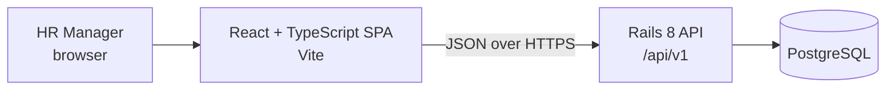
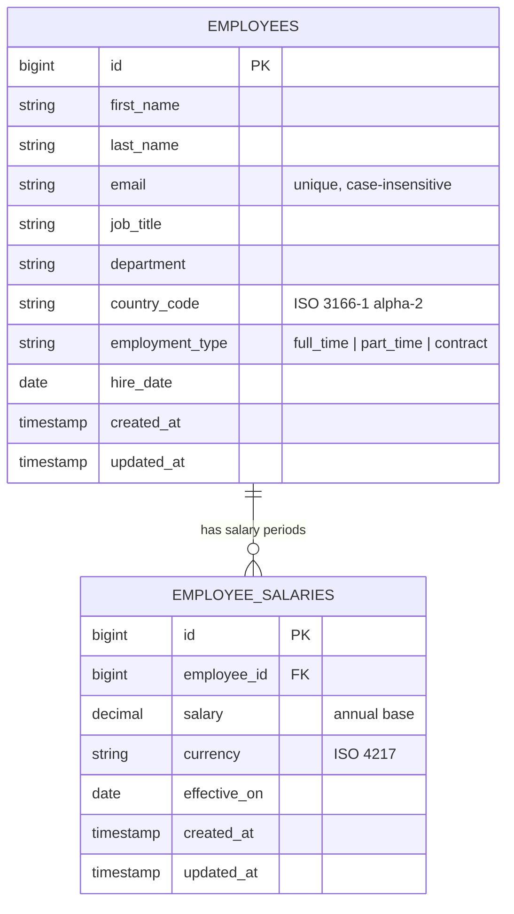

# Architecture

This document records the planned design and the reasons behind its decisions. It will be updated as implementation details are settled.

## Overview

The app has two parts in one repository: a Rails API-only backend in `backend/` and a React single-page app in `frontend/`. Each part is built, tested, and deployed on its own, and they share nothing except the HTTP contract. The API endpoints will be documented here once they are built (milestone 3c).

## Why this stack

| Choice | Reason |
| --- | --- |
| **Rails (API mode)** | It's the role's preferred stack. It provides validations, migrations, and request specs out of the box, and has very little boilerplate for a CRUD and reporting API. |
| **PostgreSQL** | The brief asks for a relational database. Postgres has `percentile_cont` for medians, `FILTER` and `GROUP BY` for reporting, check constraints, and expression indexes. It's also what we'd deploy, so development and production behave the same. |
| **React + TypeScript + Vite** | The brief asks for React. TypeScript catches mismatches with the API contract at compile time, and Vite makes the dev server and build fast. |
| **RSpec, Vitest, React Testing Library** | These are the standard tools for each side, and they run fast and give deterministic results. |

## Data model

The data model is the core of this app. Workflows edit employee and salary-period records, and insights aggregate over both, so getting their shape, constraints, and indexes right matters more than anything else in the design.

### Principles

1. **Separate employee details from salary periods.** One employee can have many salary records, each effective from a date, while employee attributes remain on one row.
2. **Money is stored in local currency, exactly.** No conversion happens on write or read. Every statistic is grouped or scoped by country, so no figure ever mixes currencies.
3. **The database guards the essentials; the models own the business rules.** The database enforces structural invariants. Business rules such as country–currency pairing live in the `Employee` and `EmployeeSalary` models. See [Where each rule is enforced](#where-each-rule-is-enforced).
4. **No structure we don't need yet.** Reference values (department, job title, country) are validated strings rather than lookup tables. The schema leaves clear paths to add other reference tables later (see [Future evolution](#future-evolution)).

### Entity diagram

Salary periods are stored in `employee_salaries`, one row per change. A period applies from `effective_on`; current salary is the latest period effective on or before today. Future-dated periods do not affect the current salary. The API and insights should use this definition when implemented.

### `employees` table

| Column | Type | Database constraint | Model validation |
| --- | --- | --- | --- |
| `id` | bigint PK | | |
| `first_name`, `last_name` | string(100) | `NOT NULL` | not blank, ≤ 100 chars, stripped of surrounding whitespace |
| `email` | string(254) | `NOT NULL`, unique index on `lower(email)` | not blank, valid format, unique (case-insensitive); stripped and downcased before save |
| `job_title` | string(100) | `NOT NULL` | not blank, ≤ 100 chars, stripped |
| `department` | string(100) | `NOT NULL` | not blank, ≤ 100 chars, stripped |
| `country_code` | string(2) | `NOT NULL` | one of the supported countries |
| `employment_type` | string | `NOT NULL` | one of `full_time`, `part_time`, `contract` (Rails `enum` with string values) |
| `hire_date` | date | `NOT NULL` | not in the future |
| `created_at`, `updated_at` | timestamp | `NOT NULL` | set by Rails |

### `employee_salaries` table

| Column | Type | Database constraint | Model validation |
| --- | --- | --- | --- |
| `id` | bigint PK | | |
| `employee_id` | bigint FK | `NOT NULL`, references `employees`, indexed with `effective_on` | required |
| `salary` | decimal(14,2) | `NOT NULL`, `CHECK (salary > 0)` | greater than zero; whole number for JPY |
| `currency` | string(3) | `NOT NULL` | supported currency; matches the employee's country when the period is created |
| `effective_on` | date | `NOT NULL` | required; may be past, current, or future |
| `created_at`, `updated_at` | timestamp | `NOT NULL` | set by Rails |

The seed will create the first salary period with each employee. Each salary change adds another row; existing periods are not overwritten. Historical rows retain their currency if the employee later moves to a different country. The employee association will delete salary periods when an employee is destroyed. The API should create the initial salary period with an employee and create a matching salary period when the employee's country changes, in the same transaction.

### Supported countries and currencies

Countries and their currencies are defined in one place: the `Country` module (`app/models/country.rb`), a frozen constant with no database table. It drives model validation, the seed script, and later the country options the UI offers. Adding a country is a code change only.

| Country | `country_code` | `currency` |
| --- | --- | --- |
| United States | `US` | `USD` |
| United Kingdom | `GB` | `GBP` |
| Germany | `DE` | `EUR` |
| France | `FR` | `EUR` |
| Netherlands | `NL` | `EUR` |
| India | `IN` | `INR` |
| Japan | `JP` | `JPY` |
| Singapore | `SG` | `SGD` |

The set mixes currencies with and without a minor unit (JPY). Three countries share EUR on purpose, so tests can show that statistics are grouped by country, not merely by currency.

### Design decisions

- **Why store currency on each salary period.** Each salary row carries its own unit, so historical pay remains interpretable if the employee changes country. The model checks the country–currency match when a new period is created.
- **Why `decimal(14,2)` and not integer cents.** Some currencies (for example JPY) have no minor unit, so a fixed "cents" assumption is wrong. `decimal` stores exact values, never has floating-point rounding errors, and aggregates (`SUM`, `AVG`, `percentile_cont`) run directly in SQL. 14 digits leaves ample headroom for large nominal amounts such as INR or JPY salaries.
- **Why strings and not lookup tables for department, job title, and country.** At this scope these values have no behaviour of their own, and normalising them would add joins and admin screens nobody needs yet. Filtering and grouping on an indexed string column is just as fast at 10,000 rows.
- **Why `lower(email)` and not `citext`.** A unique expression index gives case-insensitive uniqueness without a Postgres extension, which keeps setup and hosting simpler.
- **Why no soft delete.** The product does not require retaining deleted employee data. Delete is a real delete; soft delete would leak a `deleted_at` filter into every query.

### Where each rule is enforced

| Rule | Database | Model |
| --- | --- | --- |
| Employee fields present | `NOT NULL` | ✓ |
| Employee text length limits | column `limit` | ✓ |
| Email unique, case-insensitive | unique index on `lower(email)` | ✓ |
| Salary period fields present | `NOT NULL` | ✓ |
| Salary greater than zero | `CHECK (salary > 0)` | ✓ |
| Text fields not blank (whitespace only) | | ✓ |
| Email format; stored lowercase and stripped | | ✓ |
| Country supported; salary currency matches country when period is created | | ✓ |
| Whole-number salary for JPY | | ✓ |
| Employment type in the allowed set | | ✓ |
| Hire date not in the future | | ✓ |

**Decision.** The database enforces only the invariants that are structural and stable: a row must be complete, emails must not collide, and a salary must be a positive amount. Breaking any of these would corrupt lookups or every aggregate, and none of them changes as the business changes. Uniqueness in particular must be in the database, because a model-level check alone is open to a race between two concurrent saves.

The rest are business rules, and they live in the relevant model:

- **One source of truth.** The country–currency list, the zero-decimal currencies, and the employment types are defined once in Ruby. Mirroring them in `CHECK` constraints would duplicate those lists in SQL and require a migration to keep both in step whenever a country or type is added.
- **Simpler schema and migrations.** The schema stays readable, and changing a business rule is a code change with a spec, not a schema change.
- **Some rules can't be a constraint anyway.** "Hire date not in the future" depends on today's date, and Postgres requires `CHECK` expressions to be immutable.

**Trade-off.** Anything that bypasses Active Record validations can store data that breaks a model-only rule. That includes `insert_all`, `update_columns`, raw SQL, or a future bulk import. In this app the only such path is the seed script, so:

- The seed generator builds employee and salary rows from the same definitions the models validate against. Currency comes from `Country.currency_for`, employment type from the allowed set, and names, departments and job titles from fixed non-blank lists. JPY salaries are rounded to 1,000.
- Insights use only the current effective salary period and group by employee country and salary currency.
- Any future import path must go through the model or reuse its validations.

### Indexes and the queries they serve

| Index | Serves |
| --- | --- |
| `lower(email)` unique | Uniqueness, and search by email |
| `department` | Directory filter by department |
| `(country_code, job_title)` | "Job titles within a country" insights, the most common like-for-like comparison, and the combined country + job title filter |
| `(country_code, department)` | "Departments within a country" insights |
| `(employee_id, effective_on, id)` on `employee_salaries` | Employee salary history and current effective salary lookup |

There is no standalone `country_code` index. Both composite indexes start with `country_code`, so Postgres can use either one for a filter or grouping on country alone.

Name search uses `ILIKE` on first name, last name, and email. At 10,000 rows this is fast without a trigram index; that will be confirmed with timings on seeded data and recorded in `performance-considerations.md`.

### How insights use the model

When implemented, insight figures should be computed with SQL aggregation over employees joined to their latest salary period effective today:

- **Per country:** `GROUP BY country_code, currency` with `COUNT`, `SUM`, `MIN`, `MAX`, `AVG`, and `percentile_cont(0.5)` for the median.
- **Per job title or department:** the same aggregates, always filtered to one `country_code` first.

Because every group is scoped to a single country, and each country has exactly one currency, no statistic can mix currencies. Specs will assert this explicitly. At 10,000 rows the whole table is a few megabytes, so aggregating on request is well within budget and there is no need for precomputed summaries that could go stale.

### Seed data

`db/seeds.rb` will call `EmployeeSeed` (`lib/employee_seed.rb`) to create 10,000 synthetic employees and one initial salary period per employee.

- **Deterministic.** Headcount per country (US 3000, IN 2000, GB 1200, DE 1000, FR 800, JP 700, SG 700, NL 600) and per job title within each country is allocated from fixed weights. Every country therefore has all 8 departments and all 18 job titles, with at least 10 employees per country–job-title group and at least 30 per country–department group. Names, salary variation, employment type and hire date come from a fixed random seed, so every run produces identical data.
- **Exact salaries.** Generated from a per-title base, a country pay factor, ±20% variation and a part-time reduction, using Integer and Rational arithmetic only. Rounded to whole units (nearest 100, or 1,000 for INR and JPY).
- **No real personal data.** Names are random combinations of common first and last names. Emails use the reserved `.example` domain (`first.last.00042@acme.example`).
- **Safe to re-run.** Employee and initial salary rows are inserted in batches and in the same transaction. A second run skips existing employees and does not overwrite salary periods.
- **Limitation.** If HR changes a seeded employee's email, re-running the seed re-creates the original seeded record.

### Future evolution

The model is deliberately small, but it is shaped so the likely next steps are additive:

- **Reference data with behaviour** (for example per-department budgets, or job levels): promote the string column to a lookup table with a foreign key, using a data migration from the existing distinct values.
- **Multi-currency reporting:** add an `exchange_rates` table and convert at query time with an explicit rate date, keeping stored salaries in local currency.

## Backend structure

- **Controllers** stay thin: they handle parameter parsing and rendering only.
- **The model** owns validations and query scopes (`search`, `in_country`, and so on).
- **Query objects** (`app/queries/`) build each insight aggregation as a single SQL query, so the figures always come from live data and are easy to unit-test.
- **Serialization** is explicit and lists the fields to expose, so the API never dumps every column.

## Frontend structure

- **Data fetching:** TanStack Query, which provides caching, loading and error states, and refetching after a change.
- **Component library:** Mantine (tables, forms, and selects), so effort goes into workflows rather than UI building blocks.
- **API client:** typed with TypeScript types that mirror the API responses.
- **Pages:** the employee directory (list, filters, and create/edit) and Insights.

## Deployment (to be finalised in milestone 7)

The plan is to deploy the API and PostgreSQL to a managed host and the static frontend to a CDN. Configuration goes through environment variables (`DATABASE_URL`, `RAILS_MASTER_KEY`, the CORS origin, and the API base URL).
